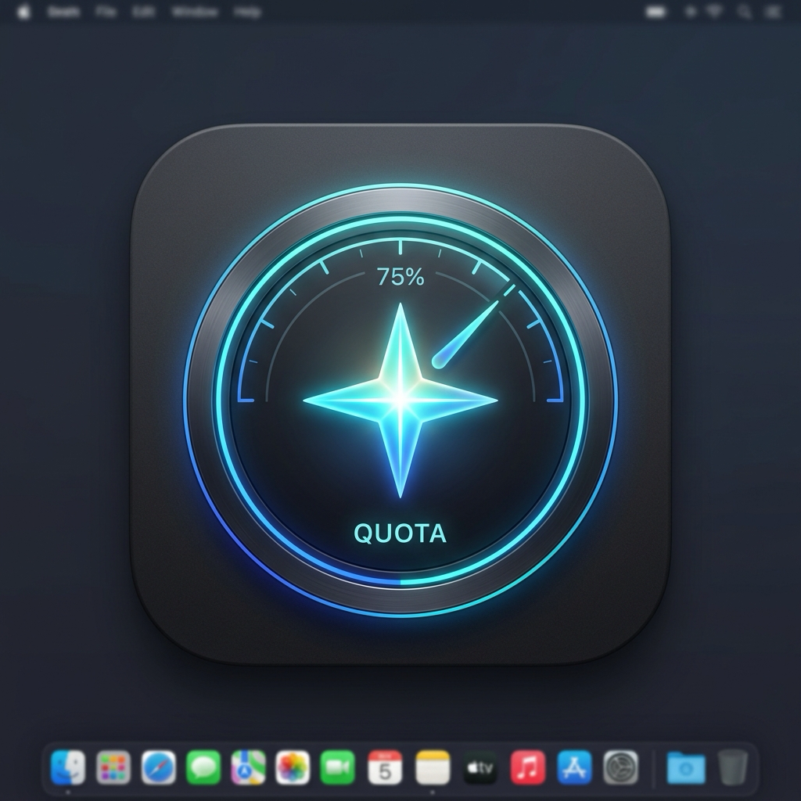

# Quản Lý & Giám Sát Quota Antigravity (Gemini Models)

<p align="center">
  
</p>

<p align="center">
  <b>Hệ thống giám sát hạn mức thời gian thực và tự động xoay tua đa tài khoản Gemini Pro / Flash cho Antigravity.</b><br>
  <i>Giao diện 100% Tiếng Việt · Cực kỳ tinh gọn · Tích hợp sẵn ứng dụng macOS 1-Click.</i>
</p>

---

## 🌟 Tính Năng Nổi Bật

* **Giao diện Tiếng Việt 100%:** Thiết kế Dark Mode hiện đại, tối giản và dễ sử dụng.
* **Tập trung vào Gemini Models:** Theo dõi chi tiết 2 hạn mức sống còn khi code:
  * **Hạn mức 5 giờ (Five-Hour Limit):** Thanh đo trực quan (% khả dụng) kèm bộ đếm ngược thời gian hồi phục chính xác (ví dụ: *Hồi sau 2h 31m*).
  * **Hạn mức Tuần (Weekly Limit):** Tỷ lệ % dung lượng còn lại trong tuần.
* **Tự động đề xuất tài khoản tốt nhất:** Hệ thống tự động phân tích và chỉ đích danh tài khoản nào đang dồi dào Quota nhất để bạn chọn dùng ngay.
* **Tự động đảo tài khoản (Auto-failover / Load Balancing):**
  * Cung cấp cổng kết nối chuẩn OpenAI-compatible tại `http://127.0.0.1:8317/v1`.
  * Khi tài khoản đang dùng chạm trần hạn mức (HTTP 429), Proxy sẽ tự động chuyển tiếp request sang tài khoản tiếp theo trong danh sách mà không làm gián đoạn công việc.
* **Thêm tài khoản 1-Click qua Google OAuth:** Chỉ cần bấm nút *Thêm Tài Khoản Mới*, trình duyệt sẽ mở trang đăng nhập Google chính thức để bạn cấp quyền trong vài giây.
* **Ứng dụng Native macOS:** Kèm theo ứng dụng `Quota Antigravity.app` với Icon thiết kế riêng, nhấp đúp trên Desktop để mở nhanh bất kỳ lúc nào.
* **An toàn tuyệt đối:** Mọi cổng kết nối đều bị khóa chặt trên `127.0.0.1` (Local Loopback), dữ liệu token được bảo vệ ở quyền riêng tư cao nhất (`chmod 600`), không có telemetry hay máy chủ bên thứ ba.

---

## 📁 Cấu Trúc Thư Mục

```text
check-quota/
├── icon.png                 # Icon ứng dụng chất lượng cao
├── AppIcon.icns             # File icon chuẩn macOS (.icns)
├── Quota Antigravity.app    # Ứng dụng Desktop native macOS
├── public/
│   └── index.html           # Giao diện Web Dashboard Tiếng Việt (HTML5/CSS3/Vanilla JS)
├── server.mjs               # Node.js backend xử lý API và truy vấn Quota từ Google
├── chay-dashboard.sh        # Script khởi chạy toàn bộ hệ thống
├── status.sh                # Script kiểm tra nhanh trạng thái tiến trình và tài khoản
├── HUONG_DAN_SU_DUNG.md     # Hướng dẫn chi tiết bằng Tiếng Việt
└── README.md                # Tài liệu dự án
```

---

## 🚀 Hướng Dẫn Sử Dụng

### 1. Khởi động nhanh (Khuyên dùng)
Nhấp đúp chuột vào ứng dụng **Quota Antigravity.app** trên màn hình Desktop của bạn. Hệ thống sẽ tự động bật các dịch vụ ngầm và mở trình duyệt tới Dashboard:
👉 **http://localhost:5200**

Hoặc chạy lệnh qua Terminal:
```bash
./chay-dashboard.sh
```

### 2. Kiểm tra trạng thái hệ thống
Chạy script kiểm tra để xem số lượng tài khoản và cổng hoạt động:
```bash
./status.sh
```

### 3. Cấu hình dùng làm Proxy cho các AI Agent / IDE
Bạn có thể kết nối các công cụ AI (Roo Code, Cline, Cursor, Continue,...) vào Proxy đa tài khoản này:
* **API Base URL:** `http://127.0.0.1:8317/v1`
* **API Key:** `123456` (hoặc bất kỳ chuỗi ký tự nào)
* **Model:** Các model Gemini hỗ trợ (ví dụ: `gemini-2.5-pro`, `gemini-2.5-flash`...)

---

## 🔒 Bản Quyền & Bảo Mật

* Dữ liệu token OAuth được lưu trữ cục bộ tại `~/Library/Application Support/com.cpa.gui/oauth`.
* Tuyệt đối không commit các file chứa token cá nhân lên Git.
